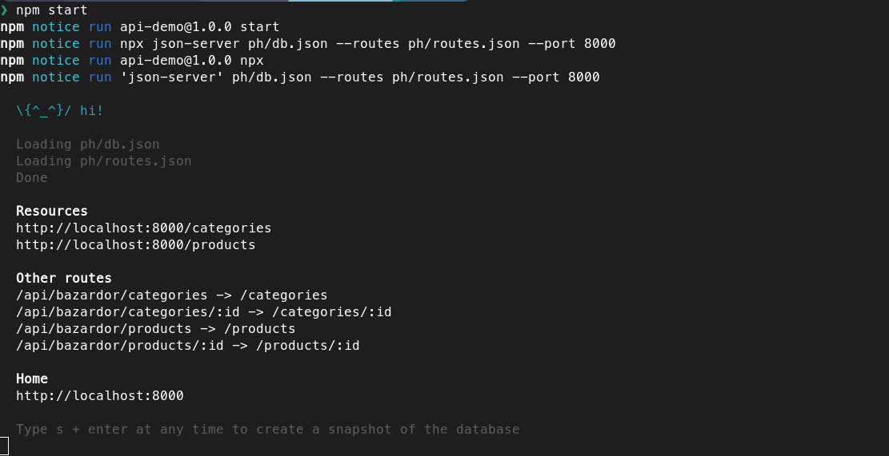
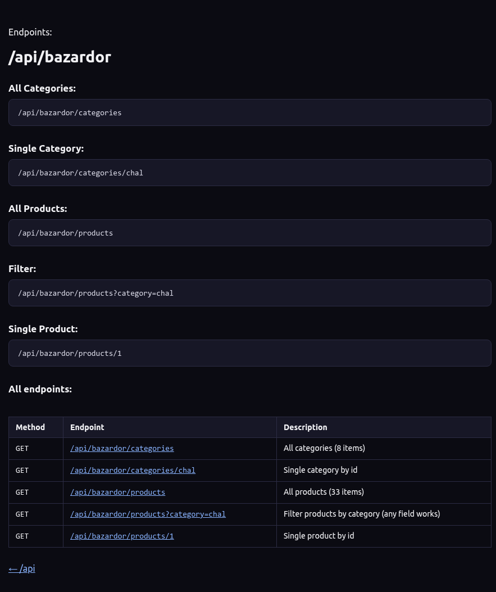

# BazarDor API

When doing the assignment the both the API link provided is rate limited. This is an API you can ran locally with same routes.

## Technologies Used

- json-server

## Features

- Run API for BazarDor Assignment locally.
- No RATE LIMIT issue.

## Project Dependency

- Node.js
- Terminal

## How to Run

1. Clone the project.
2. Open terminal and navigate to project.
3. Run below command,

```bash
npm start
```

4. Use `http://localhost:8000` as your API URL.

## Screenshot



Below are old Routes, no need to use the `/api/bazardor` as it&apos;s equivalent route is `http://localhost:8000` in `json-server`.


